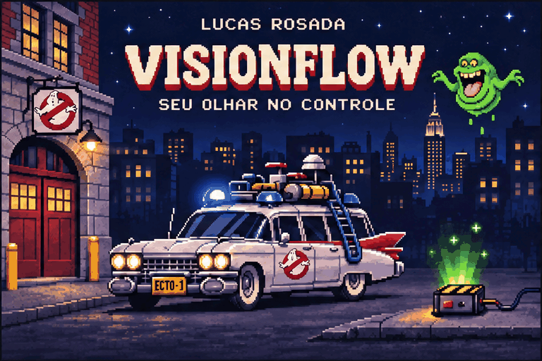

# VisionFlow



<p align="center"><strong>Seu olhar no controle.</strong><br>Controle o cursor do PC com os olhos e uma webcam.</p>

<p align="center">
  
  
  
  
</p>

## O que é

VisionFlow é um projeto experimental em Python que transforma a posição das íris em movimento do cursor real do computador. O MediaPipe localiza os olhos, o OpenCV exibe a câmera e o PyAutoGUI movimenta o mouse no monitor principal.

O controle é **direcional**: olhar para a direita move o cursor para a direita; olhar para cima move para cima. Voltar ao olhar central interrompe o movimento. O cursor não salta automaticamente para o objeto que você está olhando.

## Recursos

- Calibração do olhar central em três segundos.
- Sensibilidade ajustável, suavização e zona neutra para reduzir tremores.
- Câmera em janela, com contornos dos olhos, marcação das íris e visualização ampliada.
- Pausa do movimento quando os olhos estão fechados ou a detecção é perdida.
- Atalhos globais no Windows para ativar, pausar, recalibrar e sair.
- Processamento local: o programa não grava nem envia imagens da webcam.

**Cliques por gesto ainda não estão implementados.** Use o mouse físico para clicar.

## Instalação

Você precisa de Windows, Python 3.13, uma webcam e internet para instalar as dependências e baixar o modelo na primeira execução.

```powershell
git clone https://github.com/Lucas-Rosada/VisionFlow.git
cd VisionFlow
py -3.13 -m venv .venv
.\.venv\Scripts\python.exe -m pip install -r requirements.txt
.\.venv\Scripts\python.exe mouse_olhos.py
```

O modelo oficial do MediaPipe é salvo em `models/face_landmarker.task`. Depois da instalação e do download, o aplicativo pode funcionar sem internet. Não é necessário ativar o ambiente virtual para usar os comandos acima.

## Como usar

1. Sente-se de frente para a webcam, com o rosto iluminado e ambos os olhos visíveis.
2. Olhe para o **centro do monitor**, pressione **Espaço** e mantenha o olhar por três segundos.
3. Pressione **F8** para ativar o controle. Ele começa pausado após a calibração.
4. Olhe para os lados, para cima ou para baixo para mover o cursor. Volte ao centro para parar.
5. Se mudar de postura, use **F9** e registre novamente o centro.

Na imagem da câmera, os pontos amarelos marcam as íris. A ampliação dos olhos ajuda a conferir o rastreamento, e a seta indica a direção do movimento.

### Atalhos

| Tecla | Ação |
| --- | --- |
| **Espaço** | Iniciar a primeira calibração |
| **F8** | Ativar ou pausar o cursor |
| **F9** | Recalibrar o olhar central |
| **Esc** | Encerrar |
| **P / C / Q** | Pausar / recalibrar / sair, com a janela em foco |
| **Ctrl+C** | Encerrar pelo terminal |

Os atalhos F8, F9 e Esc funcionam mesmo com outro aplicativo em foco no Windows. A proteção do PyAutoGUI também permanece ativa: levar o mouse físico a um canto do monitor principal interrompe o controle na próxima tentativa de movimentação.

### Ajustes

```powershell
# Mais sensível
.\.venv\Scripts\python.exe mouse_olhos.py --sensibilidade 1.5

# Menos sensível
.\.venv\Scripts\python.exe mouse_olhos.py --sensibilidade 0.7

# Outra webcam
.\.venv\Scripts\python.exe mouse_olhos.py --camera 1
```

A sensibilidade padrão é `1.0`; os valores aceitos vão de `0.1` a `5.0`. Os parâmetros podem ser combinados.

## Dicas e limitações

| Situação | O que tentar |
| --- | --- |
| A câmera não abre | Feche outros apps que a utilizem, confira a permissão de câmera do Windows ou tente `--camera 1`. |
| O cursor se move sozinho | Recalibre olhando ao centro, mantenha a postura e reduza a sensibilidade. |
| O movimento responde pouco | Confira os pontos amarelos, recalibre e aumente a sensibilidade gradualmente. |
| A detecção falha | Ilumine o rosto pela frente, evite contraluz e reflexos nos óculos. |

A normalização reduz o efeito da distância e do deslocamento do rosto, mas não compensa toda rotação da cabeça. Uma webcam comum tem precisão limitada; este projeto não substitui um rastreador ocular dedicado. O controle usa o monitor principal. Outras plataformas não foram validadas.

## Estrutura

```text
VisionFlow/
├── assets/visionflow.gif   Banner animado do README
├── gaze.py                Geometria dos olhos e cálculo da velocidade
├── mouse_olhos.py          Webcam, interface, calibração e controle do mouse
├── requirements.txt       Dependências
└── README.md
```

Para verificar a sintaxe:

```powershell
.\.venv\Scripts\python.exe -m py_compile gaze.py mouse_olhos.py
```

Essa verificação não avalia a precisão do rastreamento. O comportamento real precisa ser conferido com a webcam e a calibração de quem vai usar o aplicativo.

## Autor

Desenvolvido por [Lucas Rosada](https://github.com/Lucas-Rosada). Banner inspirado em Ghostbusters e na estética dos jogos em pixel art dos anos 80.
